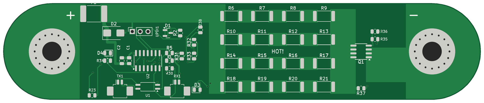
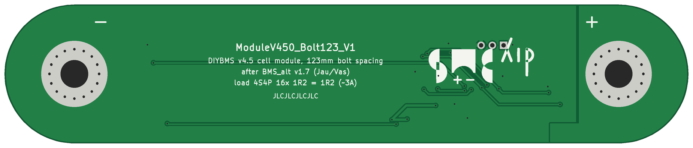
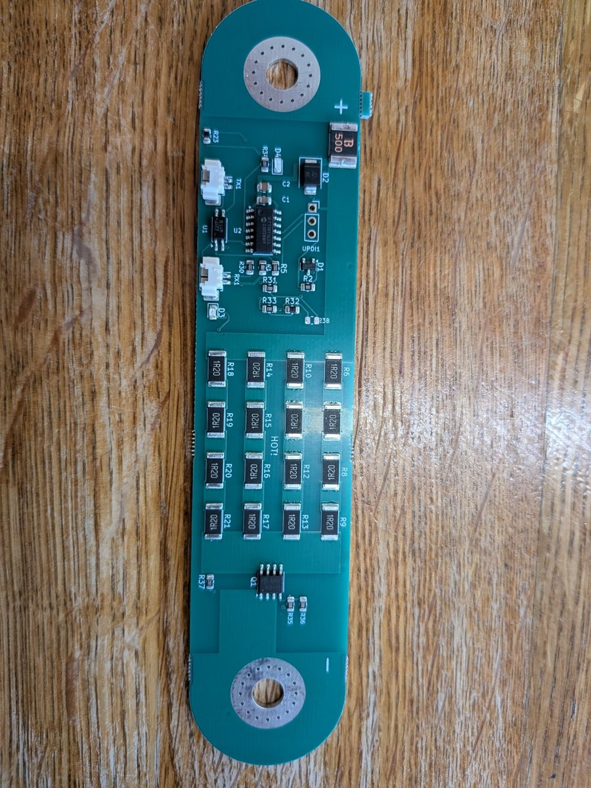
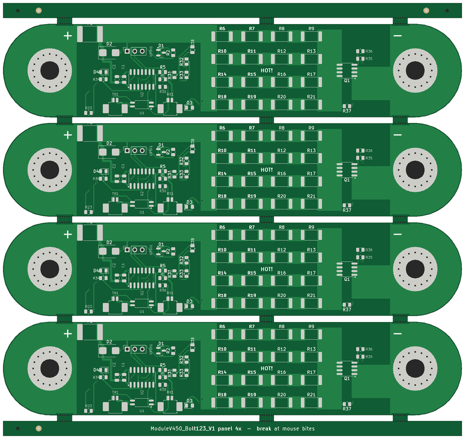

# ModuleV450_Bolt123_V1

Zellmodul DIYBMS v4.5 (ATtiny1624) im Format der BMS_alt (DIYBMS Lishen/EVE v1.7),
direkt auf die Zellpole geschraubt. EMV-optimiertes Layout.

| Oberseite | Unterseite |
|---|---|
|  |  |

*Bestückte Platine von JLCPCB (aus dem 4er-Nutzen).*

## Bestellung bei JLCPCB – alle Dateien

| Was | Einzelplatine | Nutzen 4× (empfohlen, „Panel by Customer“) |
|---|---|---|
| Gerber + Bohrdaten | `ModuleV450_Bolt123_V1_gerber_jlc.zip` | `panel4/ModuleV450_Bolt123_V1_panel4_gerber_jlc.zip` |
| Stückliste (BOM) | `ModuleV450_Bolt123_V1_bom_jlc.csv` | `panel4/ModuleV450_Bolt123_V1_panel4_bom_jlc.csv` |
| Bestückdaten (CPL) | `ModuleV450_Bolt123_V1_cpl_jlc.csv` | `panel4/ModuleV450_Bolt123_V1_panel4_cpl_jlc.csv` |
| Vollständige Stückliste | `ModuleV450_Bolt123_V1_bom_full.csv` | `panel4/ModuleV450_Bolt123_V1_panel4_bom_full.csv` |

Einstellungen: FR-4, 2 Lagen, 1,6 mm, 1 oz, grün, HASL bleifrei, PCB Assembly Oberseite.
Nutzen: *Panel by Customer*, *Edge Rails/Fiducials*: keine, *PCB Qty* = Anzahl Nutzen (5 Nutzen = 20 Module), Assembly-Menge = Anzahl Nutzen.
In der JLC-Bestückvorschau prüfen: Kathodenring D2 zur VCC-Seite (F1), Pin-1-Punkte von U1, U2, Q1 am Dreieck im Bestückdruck.

## Mechanik
| | |
|---|---|
| Platine | 154,5 × 31,5 mm (ohne Lasche) |
| Lochabstand | **123,0 mm** |
| Löcher | **6,3 mm** gebohrt, durchkontaktiert (JLC-Maximum), Ø 15 mm blanker Kupferring oben + unten, 16 Stitching-Löcher Ø 0,6 mm |
| Links / rechts | Zell-Plus (BAT+) / Zell-Minus (GND) |
| Lagen | 2, 1,6 mm FR4, 1 oz |

## Layout-Konzept (EMV)
* **Zwei Zonen:** ruhige Zone (Plus-Seite, x ≈ 12–48 mm) mit µC, Referenz D1, Optokoppler,
  Temperatursensoren, Steckern. Lastzone (x ≈ 51–116 mm) mit allen 16 Lastwiderständen,
  MOSFET Q1 und Minus-Bolzen.
* **Leistungspfade als Kupferflächen statt Leiterbahnen:**
  VCC-Einspeisung 5,8 mm breit an der Oberkante, VCC-Sammelschiene 5,4 mm,
  Reihenknoten zwischen den Widerständen je 6 × 4,2 mm, **DRAIN-Schiene 8,3 mm** über die volle Höhe
  bis an alle 4 Drain-Pins von Q1, **Source-Fläche 14 × 11 mm** von den 3 Source-Pins direkt zum Minus-Bolzen.
  Restliche Power-Bahnen 1,5 mm.
* **Laststrom-Rückweg:** Q1-Source → Kupferfläche oben → Minus-Bolzen.
  Der getaktete Laststrom fließt nicht über die Massefläche des µC.
* **Sternpunkt-Versorgung:** Der µC wird über einen eigenen Zweig versorgt
  (F1 → TVS D2 → C2 10 µF → C1 100 nF → U2 Pin 1). Er hängt nicht an der Lastschiene,
  daher misst der ADC keinen Spannungsabfall durch den Balancing-Strom.
* **Unterseite:** durchgehende GND-Fläche als Bezug und Schirm, nur am Minus-Bolzen
  mit dem Lastpfad verbunden (Sternpunkt).
* Abstand µC ↔ Lastblock ≈ 20 mm, µC ↔ Q1 ≈ 65 mm.
* Der Board-Temperatursensor R32 sitzt bewusst am Rand der ruhigen Zone, direkt neben dem Lastblock.

## Elektrik
* Last: **16 × 1,2 Ω 2512 (1 W, UniOhm 25121WF120KT4E, LCSC C46193)** – gleiche Widerstände wie BMS_alt.
  4 Stränge à 4 in Reihe, parallel = **1,2 Ω** (BMS_alt ebenfalls 1,2 Ω gesamt) → **gleicher Strom wie die alte Platine**:
  3,2 V: 2,6 A / 8,5 W · 3,4 V: 2,8 A / 9,6 W · **3,65 V: 3,0 A / 11,1 W** (0,69 W je Widerstand).
  In der Firmware `-DLOAD_RESISTANCE=1.20` setzen (siehe Abschnitt Firmware).
* **Q1 = AO4402** (SO-8, 20 V, 20 A, R_DS(on) max 7 mΩ bei U_GS = 2,5 V, LCSC C115828)
  statt AO3400A (SOT-23) bzw. LONTEN LNG045R210 (TO-252, BMS_alt). Bei 3 A ≈ 63 mW Verlust. Voll durchgesteuert auch bei LiFePO4-Zellspannung (U_GS ≈ 3 V).
  Gate über R35 510 Ω, Pulldown R36 10 kΩ (wie V450).
* **F1 = LUTE 2920L500/30GR** (PTC 2920, 5 A Halten / 10 A Auslösen, 30 V, 5 mΩ, LCSC/JLC C19078763, ca. 0,16 $)
  statt mSMD150. Hält bei 60–70 °C noch ≈ 3,5 A, also über dem Balancing-Strom von max. 3,0 A
  (die BMS_alt hatte nur 3 A Halten = genau an der Grenze). Spannungsabfall bei 3 A ≈ 15 mV.
* **Comms: TX1/RX1 = Molex PicoBlade 53261-0271** (1,25 mm, 2-polig, SMD liegend, LCSC C177225), passend zu den
  „Mini Micro JST 1,25 mm“-Kabeln. Steckeröffnung zur Unterkante, von JLC mitbestückt.
  Footprint in KiCad 0°, in der JLC-CPL 180° (das JLC-Bauteilmodell ist gegenüber KiCad um 180° verdreht).
  Pin 1 TX: TXOUT1 / Pin 2: TXOUT2 · RX: Pin 1 RXD0 / Pin 2 VCC (wie V450).
* Zelltemperatur: NTC R23 an der Unterkante direkt neben dem Plus-Bolzen; auf der Unterseite liegt darunter eine
  Kupferfläche am Plus-Pol als Wärmebrücke. Lasche, J1 und J3 entfallen.
  **R23B** = Bestückoption (nicht bestückt, gleiche Netze PA3/ENABLE) direkt am Lastblock links neben der
  VCC-Schiene. Nur R23 **oder** R23B bestücken.
* **Bei JLCPCB nicht lieferbare V450-Teile ersetzt (JLC-Lager geprüft 08.10.2026):**
  U1 EL3H7(B)(TA)-G → gleiches Teil unter **C5213653** · D1 AZ432ANTR-E1 → **TI TLV431BQDBZR (C398374)**,
  1,24 V ±0,5 %, −40…125 °C, SOT-23 Pin 1 REF / Pin 2 Kathode (beide VREF) / Pin 3 Anode (GND) – passt ohne Layoutänderung;
  Referenz 1,24 statt 1,25 V → Modul kalibrieren · D4 blau → **Everlight 19-217/BHC-ZL1M2RY/6T (C2986058)**.
* **Kosten (JLC Basic statt Extended, je 2,76 € Rüstgebühr gespart):** R5 180 Ω → **200 Ω (C17540)**,
  Optokoppler-Strom ≈ 10 mA · D4 blau → **gelb 0805 (C2296)**, U_F 1,8–2,4 V, leuchtet auch bei niedriger Zellspannung (Footprint 0603 → 0805 getauscht) ·
  U1 → **Lite-On LTV-217-B-G (C115450)**, 4-Pin-Mini-Flat 1,27 mm, Pin 1 A / 2 K / 3 E / 4 C wie EL3H7.
* Umbenennung gegenüber V450: R14→R35, R15→R36, R16→R30, R17→R37, R18→R34, R19→R32, R20→R33, R21→R31;
  Lastwiderstände R6–R21.

## Firmware (diyBMSv4ESP32 / ATTINYCellModule, Umgebung V450)
* Die Referenzspannung ist fest einkompiliert: `CellVoltage()` rechnet `U_Zelle = 1250 mV × 65535 / ADC × Calibration`
  (`packet_processor.cpp`, Referenz am Pin PA5 wird gegen VDD gemessen).
* D1 TLV431BQ liefert 1,24 V statt 1,25 V → ohne Kalibrierung zeigt das Modul ca. 0,8 % zu viel an (bei 3,3 V ≈ +27 mV).
  Korrektur ohne neue Firmware: im Controller pro Modul den Kalibrierfaktor auf ca. **0,992** setzen
  (mit Multimeter abgleichen; erlaubter Bereich 0,8–10, Standard 1,0).
  Alternativ in `packet_processor.cpp` 1250L → 1240L ändern.
* In `platformio.ini` (Umgebung V450) **`-DLOAD_RESISTANCE=3.30` → `1.20`**, sonst werden Balancing-Strom
  und -Energie im Controller falsch angezeigt (der Wert wird nur dafür verwendet).

## Prüfung
KiCad-DRC: 0 Fehler, 0 offene Verbindungen (nur Silkscreen-Hinweise).

## Dateien
* `ModuleV450_Bolt123_V1_gerber_jlc.zip` – Gerber + Bohrdaten für JLCPCB
* `ModuleV450_Bolt123_V1_bom_jlc.csv` / `_cpl_jlc.csv` – SMT-Bestückung Oberseite
* `ModuleV450_Bolt123_V1_bom_full.csv` – vollständige Stückliste
* `ModuleV450_Bolt123_V1.kicad_pcb` – KiCad-7-Layout, `scripts/` – Generator-Skripte

Handbestückung: nur optional UPDI1 und ggf. R23B (statt R23).

## Nutzen für JLCPCB („Panel by Customer“)
Ein fertiger Nutzen liegt in `panel4/`. „Panel by JLCPCB“ ist wegen der runden Enden nicht möglich.

| | |
|---|---|
| Inhalt | **4 × ModuleV450_Bolt123_V1** untereinander |
| Größe | **154,5 × 146,0 mm** |
| Trennung | 2 mm Frässchlitz, je Längskante 3 Stege à 5 mm (bei x = 5 / 73 / 118 mm, gerade Kante zwischen den Bolzen) mit 7 Sollbruchlöchern Ø 0,5 mm (Mouse Bites); Kupfer an den Stegen 0,7 mm zurückgesetzt, keine Leiterbahn an den Stegen |
| Randstreifen | oben und unten je 5 mm, mit 3 Werkzeuglöchern Ø 1,152 mm (JLC-Standard, asymmetrisch) und 3 Passermarken (1 mm Kupfer, 2 mm Maskenöffnung) |
| Bestückung | `ModuleV450_Bolt123_V1_panel4_bom_jlc.csv` + `_cpl_jlc.csv`, Bezeichner R1_1 … R1_4 (Nutzenplatz 1 = oben) |

**Bestellung bei JLC für 20 Module:**
* Gerber: `ModuleV450_Bolt123_V1_panel4_gerber_jlc.zip`
* *Panel Format*: **Panel by Customer**, *Different Design*: 1, *Edge Rails/Fiducials*: **keine** (sind schon im Nutzen)
* *PCB Qty*: **5** (Nutzen) → 20 Module
* PCB Assembly: Menge 5, BOM und CPL aus `panel4/`
* Erzeugt mit `scripts/panel.py` (`panel.py <board> <out> 4 5,73,118 ModuleV450_Bolt123_V1`) und `scripts/jlc.py`.

## JLCPCB
* D2 (SMB, SMBJ5.0A C440263): JLC-Modell liegt wie KiCad → CPL-Drehung ohne Korrektur; Kathodenring muss auf der VCC-Seite (Pad 1) liegen (in der JLC-Vorschau geprüft 09.10.2026).
* U1 (SOP-4, LTV-217): JLC-Bauteilmodell ist gegenüber KiCad um 180° verdreht → CPL-Drehung +180° (in der JLC-Vorschau geprüft 09.10.2026).
* CPL-Positionen = Mitte der Kupfer-Pads (wie JLC die Bauteile setzt). Beim PicoBlade TX1/RX1 liegt der KiCad-Nullpunkt 0,6 mm daneben; ohne diese Korrektur ragte der Stecker in der JLC-Vorschau über die Kante (Bauteilmitte korrigiert 09.10.2026).
FR-4, 2 Lagen, 1,6 mm, grün, LeadFree HASL, 16 Stück, PCB Assembly Top Side mit BOM + CPL.
Drehungen in der JLC-Vorschau prüfen.
